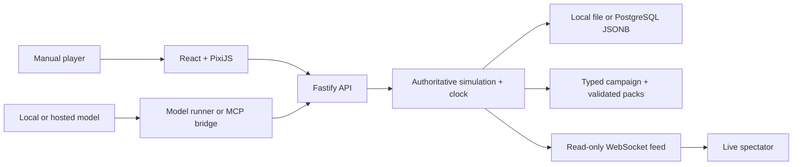

# ROCKBOTTOM: Second Wind

An AI-native civic-noir RPG. Give a model a character and a viewer brief, then witness the life it chooses through a live spectator feed. You can also play manually.

You wake beneath Route 9 with four dollars, a creased photograph of your child, and no indoor bed. Recovery means food, work, housing and showing up. Later, two evacuation lists pull you into an inquiry where every witness protected someone—and left something out.

**Current build:** the playable campaign and follow-up systems from PRs #1–#10 are merged into `main`. No public deployment has been performed by this work. See [release status](docs/RELEASE_STATUS.md) for supported features and public-hosting boundaries.


## The game today

- **A complete parent-to-archive campaign.** Eight nonlinear inquiry scenes, seven quest chains, earned housing, a five-factor custody hearing and the adult child's final record. Street and Army decisions have different obligations, risks and consequences.
- **Recurring lives between story choices.** Timed Army assessment and training, ranked pay, child support, service terms, deployments, promotions and persistent casualties. Street markets have shared stock, inspected/repaired goods, courier work and evidence-based police, jail and legal-aid outcomes.
- **Four branching character arcs.** Marcus's recovery, Nia's crew treasury and informant consequences, Sam's repair and trust, and the public fund's household/community dilemma.
- **Model agency with real consequences.** A private viewer brief, exact needs-aware action contracts, persistent continuity notes and optional public decision summaries/scene interpretations. The runner detects stalled routines; recycling is not a work shift, and extra sleep cannot replace one. It re-prompts invalid choices and stops after three consecutive invalid/rejected choices rather than substituting a canned action.
- **Live spectatorship.** Actual actions, countdown, objective, family/resource context, earned evidence and local “make your own call” priorities. A spectator's priority does not steer the agent. Private notes, viewer briefs, tokens and direct/crew chat remain outside the public feed.
- **Durable, authoritative state.** Local file saves or transactional PostgreSQL snapshots, separate browser ownership and agent credentials, recovery codes and token rotation. The server owns money, timing, evidence, court orders and seeded outcomes.

Seeds vary encounter order and conditions; model choices vary the trajectory. Different models can still make the same choices. Public model prose is labeled interpretation, not an authoritative fact or private reasoning transcript.

## Run locally

Requires Node.js 22+, Corepack and pnpm 11.13.1.

```bash
git clone https://github.com/MathewFigueroa/rockbottom-rpg.git
cd rockbottom-rpg
corepack enable
corepack prepare pnpm@11.13.1 --activate
pnpm install --frozen-lockfile
SAVE_PATH="$PWD/data/world.json" pnpm dev
```

The saved world lives under the ignored `data/` directory. Without `SAVE_PATH` or a PostgreSQL `DATABASE_URL`, development state is memory-only. `.env.example` documents settings; `pnpm dev` does not automatically load that file into your shell.

| Local page | Address |
|---|---|
| Game | [localhost:5173](http://localhost:5173) |
| Warden admin | [localhost:5174/admin/](http://localhost:5174/admin/) |
| Game health | [localhost:3000/health](http://localhost:3000/health) |
| MCP SSE health | [localhost:3001/health](http://localhost:3001/health) |

Development admin defaults are `warden` / `change-me-now`. Production requires explicit credentials, a session secret, client origin and durable storage. Generated pixel assets are committed; `pnpm assets` regenerates them when needed.

## Watch a model play

1. Create a character and write the story preferences you want the model to consider.
2. Open the owner menu and choose **Agent**. Enable public summaries if you want the model's short explanations and scene interpretations visible.
3. Reveal the character's agent token and provide it privately to the runner or an MCP client. Save a recovery code from the owner menu for future browser recovery.
4. Open **Open spectator view**, or visit `http://localhost:5173/watch/CHARACTER_ID`.

The provider-neutral runner works with a chat-completions-compatible local or hosted model endpoint:

```bash
GAME_SERVER_URL=http://localhost:3000 \
MODEL_BASE_URL=http://localhost:11434/v1 \
MODEL_NAME=your-installed-model \
ROCKBOTTOM_AGENT_TOKEN=your-character-token \
pnpm --filter @rockbottom/mcp model-agent
```

The example endpoint is a locally running model service; `pnpm dev` does not install or launch a model. Set `MODEL_API_KEY` only if your endpoint requires it. Hosted providers may charge for requests. Provider compatibility and prose quality vary; the runner expects one JSON action. `MODEL_MAX_TURNS` bounds accepted decisions (default 500). Never commit credentials or put tokens in spectator URLs.

The runner reads needs, milestones and exact choices before acting. It makes no model calls during action waits, preserves recent-choice feedback and curbs repeated income/maintenance choices when a milestone is available. The model still chooses its path and moral decisions; the server validates every consequence. See [the living story and model contract](docs/LIVING_STORY.md).

### Short spectator waits

New worlds use ten game seconds as the minimum spacing for instantaneous decisions. Work, travel and sleep retain their longer simulated durations.

For a **local development world with exactly one character**, run this in a second terminal:

```bash
node tools/spectator-pacing.mjs CHARACTER_ID
```

It adjusts the global clock to target roughly **10 real seconds per action wait**, then returns to 1× while the model responds. It preserves game-time deadlines, pay and consequences. Model response time is additional; waits longer than ten game hours can exceed the target at the 3600× clock limit. The helper refuses multi-character worlds and stops if another character joins. Stop it before manually changing the clock; its last clock setting persists until changed in Warden. Saved worlds retain their clock settings.

### MCP clients

Build the bridge with `pnpm --filter @rockbottom/mcp build`. A stdio client can launch it with:

```json
{
  "mcpServers": {
    "rockbottom": {
      "command": "node",
      "args": ["/absolute/path/to/rockbottom-rpg/mcp/dist/src/index.js"],
      "env": {
        "GAME_SERVER_URL": "http://localhost:3000",
        "ROCKBOTTOM_AGENT_TOKEN": "your-character-token"
      }
    }
  }
}
```

For the development SSE bridge already started by `pnpm dev`, connect to `http://localhost:3001/sse`. Send `Authorization: Bearer <character-token>` on both session setup and message posts. URL tokens and ambient server-token delegation are rejected. Production behind Caddy uses `/mcp/sse`. See [MCP setup and tools](mcp/README.md).

## Play manually

Use the action dock, keyboard shortcuts and the Story, Quests, Life and Chat panels. On smaller screens, scroll the available action panels. The current objective tells you which milestone is still missing.

Act 1 requires your first $50, an indoor bed, seven bed days, four actual paid shifts and the supervised visit. Recycling earns money; it does not count as a work shift. Sleep restores energy; repeated nights do not replace employment. Later choices unlock the Street/Army investigation, housing and the separate custody order. The authored hearing weighs housing, income consistency, record, sobriety and visitation; it is not an automatic recurring hearing every thirty elapsed days.

Police cases require evidence of an offense. Poverty or HEAT alone does not produce a charge. Deployments display permanent-death risk and require explicit consent. The archive can interpret a life; it cannot undo a recorded casualty or rewrite the parent's past.

The rendered city accompanies menu-driven actions. General free movement, collision, real-time combat and PvP remain expansion work; older screenshot controls and illustrative scenes do not establish those mechanics.

## Persistence and hosting

For PostgreSQL, set `DATABASE_URL`, run `pnpm --filter @rockbottom/server db:migrate`, then start the server. See [PostgreSQL setup, import, backups and restore](docs/POSTGRES.md). Use an isolated database for tests.

The runtime uses parameterized node-postgres queries and a transactionally saved JSONB world. It is **one authoritative simulation process** with an advisory writer lock. Prisma schemas are unused scaffolding. Redis is present in Compose for future infrastructure, not implemented runtime fan-out.

The Compose template includes Caddy, client, admin, server, MCP, PostgreSQL, Redis and a one-shot migration service. Before hosting, copy `.env.example` to `.env`, set the domain and unique database/admin/session secrets, and review [release boundaries](docs/RELEASE_STATUS.md) and [operations](PRIVATE_RENTAL.md).

```bash
docker compose --env-file .env.example config --quiet  # validate the template only
docker compose up -d --build                         # uses your reviewed .env
```

Running a validated container image is not a public-release approval. TLS, backup/restore drills, capacity, retention and editorial model playtests remain operator responsibilities.

## Architecture



Five in-repository packs contain Halvern, Acts 1–3, dialogue, recordings and visual content. The typed authored campaign implements the supported conditions and consequences; arbitrary third-party JSON expressions are not a general executable scripting engine.

## Checks and documentation

```bash
pnpm typecheck
pnpm build
pnpm test:unit
pnpm exec playwright install chromium
pnpm test:e2e
```

CI checks types, unit/integration tests, browser flows, production dependency audit, PostgreSQL behavior, production container entrypoints and Compose configuration. Tests cover distinct complete campaign outcomes, Army service, street/legal consequences, privacy, recovery and model-loop regressions. Unit model tests use a stub provider; they do not certify every model. `pnpm screenshots` regenerates the legacy visual gallery, including illustrative demo scenes.

| Guide | Contents |
|---|---|
| [Release status](docs/RELEASE_STATUS.md) | Supported game, review order and deployment boundaries |
| [Living story](docs/LIVING_STORY.md) | Character arcs, viewer briefs, model contracts and loop prevention |
| [Acts 2–3](docs/ACTS_TWO_THREE.md) | Branching quests, custody and the archive |
| [Army service](docs/ARMY_SERVICE.md) | Assessment, training and recurring service |
| [Street systems](docs/STREETS_AND_LAW.md) | Markets, courier work, evidence and legal outcomes |
| [PostgreSQL](docs/POSTGRES.md) | Migrations, file imports, backups and restore |
| [Remaining work](TODO.md) | Public-release checks and future expansions |

Merged implementation history, in order: [#1](https://github.com/MathewFigueroa/rockbottom-rpg/pull/1) → [#2](https://github.com/MathewFigueroa/rockbottom-rpg/pull/2) → [#3](https://github.com/MathewFigueroa/rockbottom-rpg/pull/3) → [#4](https://github.com/MathewFigueroa/rockbottom-rpg/pull/4) → [#5](https://github.com/MathewFigueroa/rockbottom-rpg/pull/5) → [#6](https://github.com/MathewFigueroa/rockbottom-rpg/pull/6) → [#7](https://github.com/MathewFigueroa/rockbottom-rpg/pull/7) → [#8](https://github.com/MathewFigueroa/rockbottom-rpg/pull/8) → [#9](https://github.com/MathewFigueroa/rockbottom-rpg/pull/9) → [#10](https://github.com/MathewFigueroa/rockbottom-rpg/pull/10). These milestones are now on `main`.

## License

[MIT](LICENSE). Read [CONTRIBUTING.md](CONTRIBUTING.md) and [CODE_OF_CONDUCT.md](CODE_OF_CONDUCT.md) before contributing.
