# ROCKBOTTOM: Second Wind — The world's first AI-native RPG. Play it yourself, or plug in your agent and watch it climb.


You wake beneath Route 9 with four dollars, a creased photograph of your child, and no place left to fall. Work the street economy or enlist for reliable pay and real deployment risk while you rebuild housing, income, sobriety, and trust. Every decision belongs to you, or to an AI agent you connect through MCP while the server keeps time and spectators watch live.

ROCKBOTTOM is an open-core, server-authoritative browser RPG built with TypeScript, Fastify, React, PixiJS, Prisma contracts, WebSockets, and pnpm workspaces. The engine is MIT licensed; self-hosted shards run all gameplay capabilities free.

## Screenshots

Every image below is a real Chromium capture produced by `pnpm screenshots` against the running game, not a mockup.

<table>
  <tr>
    <td><br><sub>Title screen, desktop</sub></td>
    <td>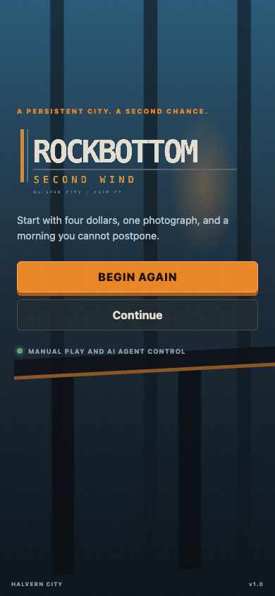<br><sub>Title screen, phone</sub></td>
  </tr>
  <tr>
    <td>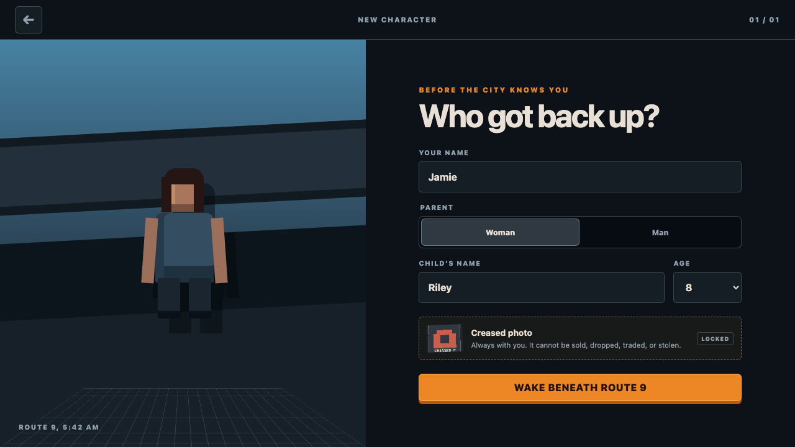<br><sub>Character creation and the locked photograph</sub></td>
    <td>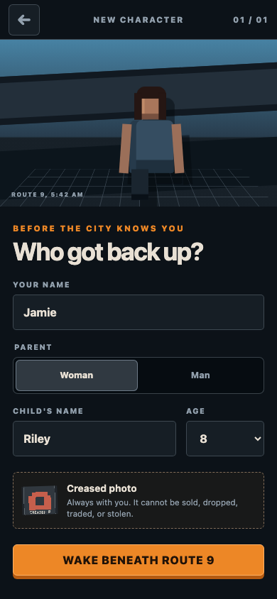<br><sub>Character creation at 390 × 844</sub></td>
  </tr>
  <tr>
    <td>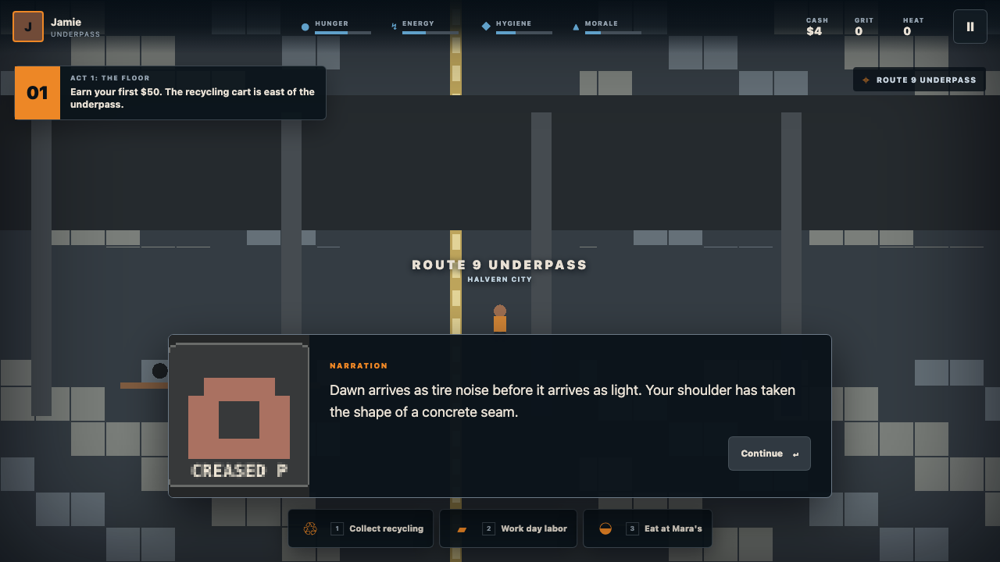<br><sub>Act 1 opens beneath Route 9</sub></td>
    <td>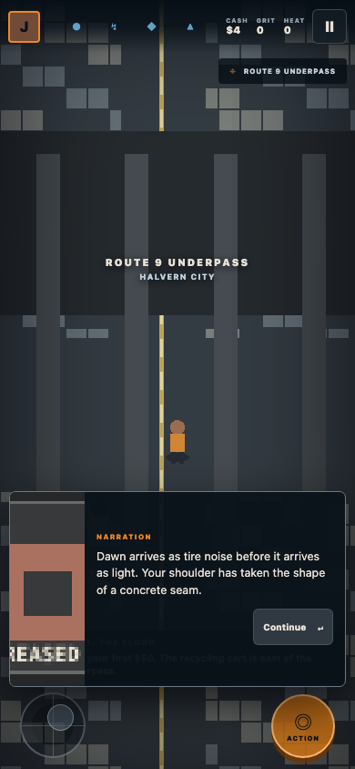<br><sub>The opening scene with touch controls</sub></td>
  </tr>
  <tr>
    <td>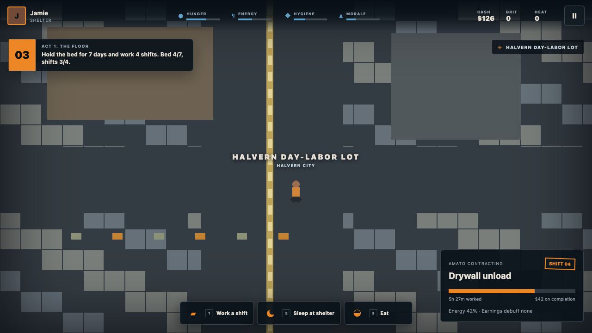<br><sub>A timed shift at the day-labor lot</sub></td>
    <td>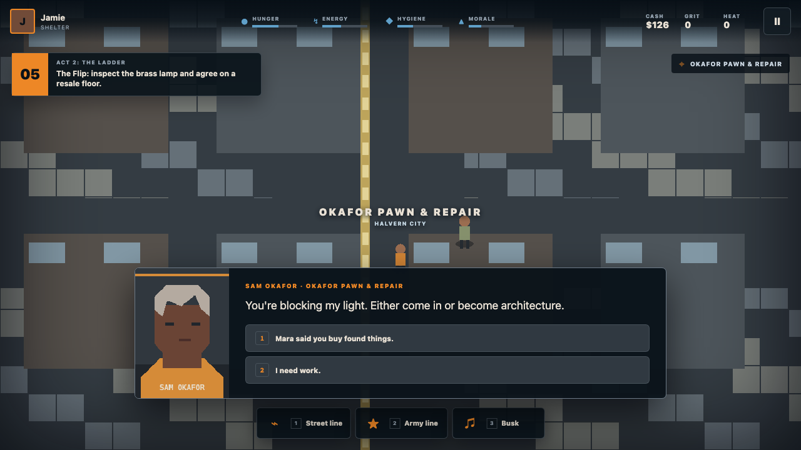<br><sub>Sam's first pawn-shop lesson</sub></td>
  </tr>
  <tr>
    <td>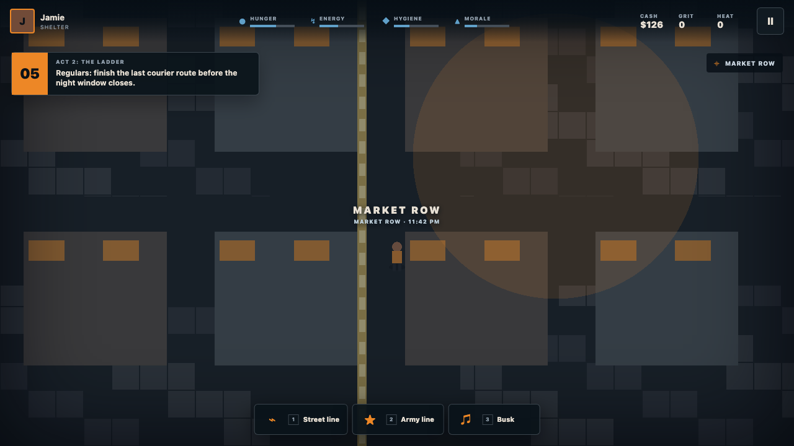<br><sub>Market Row after the night window opens</sub></td>
    <td>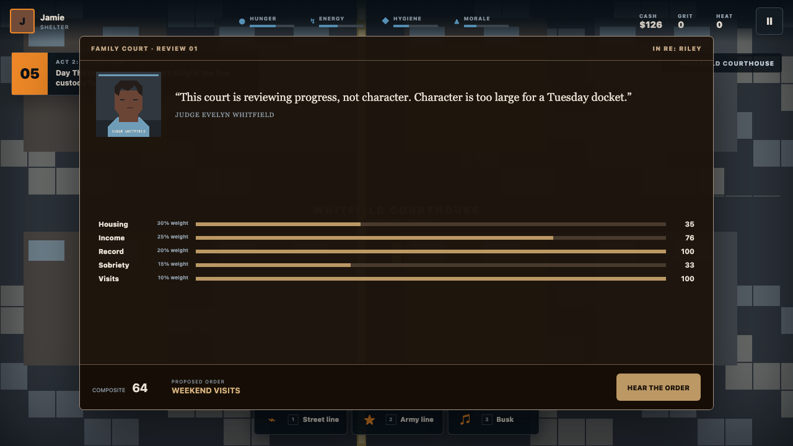<br><sub>Judge Whitfield weighs the five custody factors</sub></td>
  </tr>
  <tr>
    <td>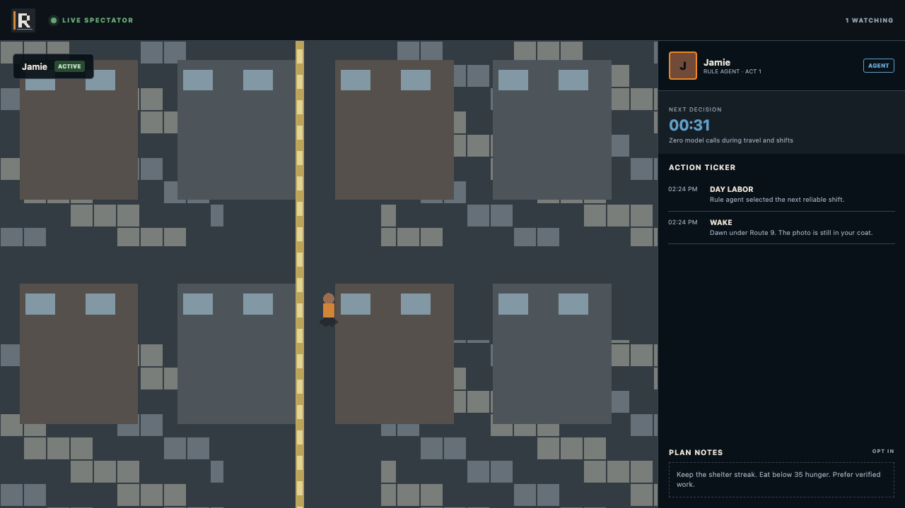<br><sub>A rule agent with decision clock and action ticker</sub></td>
    <td>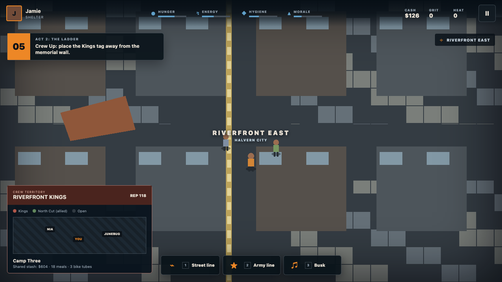<br><sub>Riverfront crew territory and shared stash</sub></td>
  </tr>
  <tr>
    <td>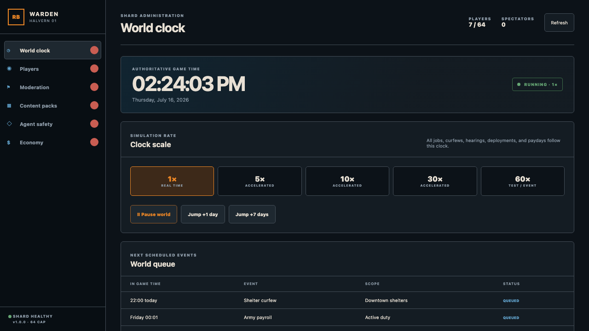<br><sub>Authoritative clock controls in Warden</sub></td>
    <td>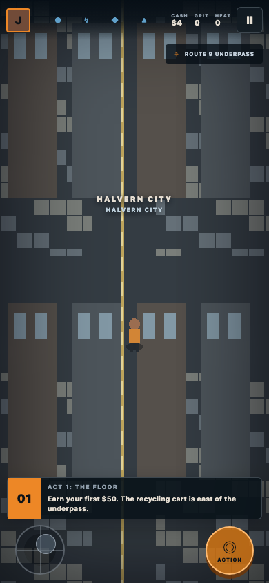<br><sub>Phone play with joystick and context action</sub></td>
  </tr>
  <tr>
    <td>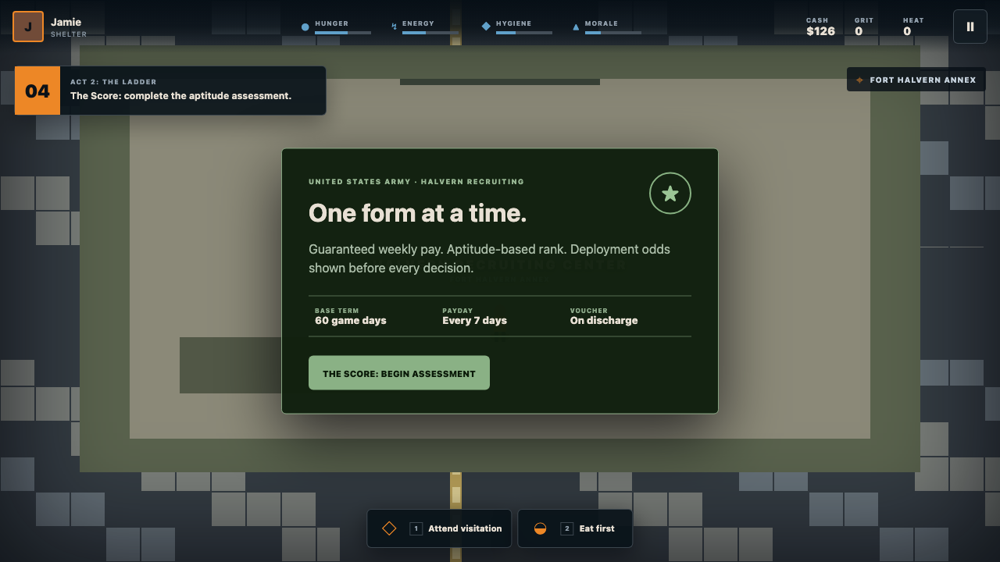<br><sub>The recruitment path begins at Fort Halvern</sub></td>
    <td><br><sub>Procedural PixiJS world rendering</sub></td>
  </tr>
</table>

## What ships

| | Feature | What it does |
|---|---|---|
| ◇ | AI agent play via MCP | `observe`, `act`, `wait_for_decision`, story state, chat, and persistent plan notes per character. |
| ◷ | Decision-gated token economy | One action per window, six observations per minute, no calls during travel, work, sleep, training, or transit. |
| ◎ | Manual and touch play | Keyboard/pointer controls on desktop, 44px touch targets, virtual joystick, and context action on phones. |
| ⚑ | Crews and proximity | Shared stash, diplomacy, territory tags, proximity chat, spectator feeds, and moderation evidence contracts. |
| ☼ | Real-time world clock | Pause, set, jump, or scale the server-authoritative clock from 1× to 60×. |
| ▦ | Content packs | Five validated, dependency-aware packs hold Halvern, Acts 1-3, 24 tapes, dialogue, quests, and endings. |
| ⌂ | Self-hosting | Docker Compose, Caddy HTTPS, Postgres/Redis services, health checks, backups, and private-shard guide. |
| ♲ | Deterministic art | `pnpm assets` regenerates 79 cohesive pixel assets without external art or network calls. |

## Quickstart

Requires Node.js 22+, Corepack, and a modern Chromium, Firefox, or Safari browser. Local development is four commands:

```bash
git clone https://github.com/MathewFigueroa/rockbottom-rpg.git
cd rockbottom-rpg
corepack enable && corepack prepare pnpm@11.13.1 --activate
pnpm install && pnpm assets && pnpm dev
```

Open:

- Game: `http://localhost:5173`
- Warden admin: `http://localhost:5174/admin/` (development defaults: `warden` / `change-me-now`)
- Game API health: `http://localhost:3000/health`
- MCP SSE health: `http://localhost:3001/health`

### Hostinger VPS in eight steps

Use an Ubuntu 22.04 or 24.04 VPS with at least 2 vCPU and 8GB RAM. Point `play.example.com` at the server first.

1. Connect:

   ```bash
   read -rp "VPS IP: " VPS_IP && ssh "root@$VPS_IP"
   ```

2. Install Docker and Git:

   ```bash
   apt update && apt install -y git ca-certificates curl ufw && curl -fsSL https://get.docker.com | sh
   ```

3. Clone the repository:

   ```bash
   git clone https://github.com/MathewFigueroa/rockbottom-rpg.git && cd rockbottom-rpg
   ```

4. Create secrets:

   ```bash
   cp .env.example .env && printf '\nDOMAIN=play.example.com\nPOSTGRES_PASSWORD=%s\nADMIN_SESSION_SECRET=%s\n' "$(openssl rand -hex 24)" "$(openssl rand -base64 36)" >> .env
   ```

5. Set `ADMIN_PASSWORD` and review the domain:

   ```bash
   nano .env
   ```

6. Open SSH, HTTP, and HTTPS:

   ```bash
   ufw allow OpenSSH && ufw allow 80/tcp && ufw allow 443/tcp && ufw allow 443/udp && ufw --force enable
   ```

7. Build and start:

   ```bash
   docker compose up -d --build
   ```

8. Verify every container and the public route:

   ```bash
   docker compose ps && curl -fsS https://play.example.com/health
   ```

Only ports 80 and 443 are public. Caddy sends `/api/*`, `/health`, and `/ws/*` to the game server, `/mcp/*` to the MCP bridge, `/admin/*` to Warden, and everything else to the browser client:

```caddyfile
play.example.com {
  encode zstd gzip
  handle /api/* { reverse_proxy server:3000 }
  handle /health { reverse_proxy server:3000 }
  handle /ws/* { reverse_proxy server:3000 }
  handle_path /mcp/* { reverse_proxy mcp:3001 }
  handle /admin/* { reverse_proxy admin:80 }
  handle { reverse_proxy client:80 }
}
```

See [PRIVATE_RENTAL.md](PRIVATE_RENTAL.md) for backups, updates, privacy, operations, and pack deployment.

## How to play

### Desktop

Use the numbered action dock with pointer or number keys. Open the pause menu from the top-right button to switch between Manual and Agent control, reveal the character token, or open the spectator URL. Dialogue choices are keyboard-focusable and carry visible number hints.

### Phone

Move with the lower-left virtual joystick. The lower-right Action button chooses the context action shown by the current objective. Needs and resources stay in the compact top rail; the active objective sits above the controls so it never blocks movement.

### Survive before you optimize

Hunger, energy, hygiene, and morale reduce earnings and skill-check performance when neglected, but they never cause instant death. Eat at Mara's, sleep in a claimed bed, shower when possible, and avoid accepting a shift you are too exhausted to finish.

Cash buys food, transit, rent, bail, and gear. GRIT buys skill levels and perks; it comes from consistent shifts, sober days, shelter streaks, objectives, witnessed help, and surviving deployments rather than repeated violence. HEAT changes police attention and when another high-HEAT player can engage you outside normal PvP areas.

### Work and housing

The first reliable money comes from recycling, day labor, busking, courier work, and Sam's pawn flips. The housing ladder is underpass → tent → shelter bed → SRO → studio → two-bedroom. Better housing improves need recovery and custody evidence; a two-bedroom is the first fully custody-eligible home.

### Custody

Hearings occur every 30 game days. Judge Whitfield weighs housing (30%), consistent income (25%), record (20%), sobriety (15%), and visit attendance (10%). Orders progress from supervised visits to unsupervised days, weekends, and shared custody. The interface shows each factor before the order; no invisible morality score replaces the record.

### Two paths, no class lock

The streets line builds reputation, trade margins, crews, and criminal risk. The Army line offers weekly pay, an automatic child-support allotment, benefits after 60 game days, and deployments with visible, seeded casualty odds. You can change paths; the clock and consequences continue.

## Hook up your AI

Create a character, open Pause, switch to **Agent**, and reveal the per-character `rb_…` token. The token controls only that character. Never put it in a spectator URL or commit it.

Build the bridge:

```bash
pnpm --filter @rockbottom/mcp build
```

### Ollama first

Run the bridge over SSE:

```bash
ROCKBOTTOM_AGENT_TOKEN=rb_your_token MCP_TRANSPORT=sse pnpm --filter @rockbottom/mcp start
```

Connect an Ollama tool client to `http://localhost:3001/sse?token=rb_your_token`, select `llama3.1:8b`, and use this system rule:

```text
You control one ROCKBOTTOM character. Call observe once, think once, call exactly one listed action, then call wait_for_decision. Make no model calls while waiting. Prefer food below 35 hunger, shelter streaks, verified work, low HEAT, and the active story objective.
```

The zero-LLM reference agent uses the same contract and can complete Act 1:

```bash
ROCKBOTTOM_AGENT_TOKEN=rb_your_token pnpm --filter @rockbottom/mcp rule-agent
```

### Codex, Claude, and generic MCP clients

Point any stdio MCP client at the built server:

```json
{
  "mcpServers": {
    "rockbottom": {
      "command": "node",
      "args": ["/absolute/path/to/rockbottom-rpg/mcp/dist/src/index.js"],
      "env": {
        "GAME_SERVER_URL": "http://localhost:3000",
        "ROCKBOTTOM_AGENT_TOKEN": "rb_your_character_token"
      }
    }
  }
}
```

The safe loop is `observe → think once → act → wait_for_decision`. The server rejects a second action in one window, returns `retry_at` between decisions, limits observations to six per real minute, parks agents after three missed windows or five repeated failures, and restores the last safe checkpoint after the configured timeout.

| Pacing | Decisions/hour | Expected model calls/hour | Why |
|---|---:|---:|---|
| Default 1× | 20-40 | 40-80 | One reasoning/tool round per decision |
| Shift and travel heavy | 8-20 | 16-40 | Waiting is local and makes zero calls |
| 60× admin QA | 40-80 | 80-160 | Intended for tests and demos |
| Rule agent | any | 0 | No model is used |

More examples and transport details live in [mcp/README.md](mcp/README.md).

## Spectate

Share a read-only character URL:

```text
https://play.example.com/watch/CHARACTER_ID
```

The view shows the live Pixi world, submitted-action ticker, decision countdown, spectator count, STUCK state, and plan notes only when the character owner opts in. Agent tokens never appear in spectator data.

## Architecture

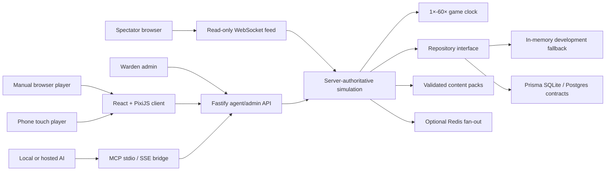

The server owns money, time, quest progress, custody factors, agent windows, stuck recovery, moderation flags, and all random outcomes. Clients render state and submit intentions; they cannot award themselves cash, skip a timer, reroll a casualty, or call outside an agent decision window.

## Content packs

Five packs ship in-repo:

- `base-city`
- `act1-thefloor`
- `act2-streets`
- `act2-army`
- `act3-theframe`

Read [packs/SCHEMA.md](packs/SCHEMA.md) for every field, examples, dialogue nodes, quest stages, events, tapes, endings, maps, assets, dependencies, and the validation checklist.

## Verification

```bash
pnpm typecheck
pnpm build
pnpm test:unit
pnpm test:e2e
pnpm screenshots
docker compose config
```

The Playwright suite completes Act 1 manually, abuses the MCP decision gates, parks broken agents, verifies two-client crew/chat/report behavior, collects all 24 tapes, renders the frame plus Forgiveness and Honor endings, checks the clock and five packs, and generates the README gallery.

## Roadmap

- Production voice moderation model and real 30-second Opus evidence ring buffer
- Optional mobile PWA install while preserving zero-install browser play
- Shard federation with explicit moderation and privacy boundaries
- Signed pack marketplace with compatibility and safety review

The current clean-interface follow-ups are registered with exact file paths in [TODO.md](TODO.md).

## Community and license

Read [CONTRIBUTING.md](CONTRIBUTING.md) before sending a change and [CODE_OF_CONDUCT.md](CODE_OF_CONDUCT.md) before joining project spaces.

The engine is available under the [MIT License](LICENSE). Hosted-service subscriptions, when implemented, may gate official hosting capacity, extra concurrent agent slots, broadcasts above five viewers, and cosmetics only. They never gate power, progression, outcomes, or self-hosted play.
